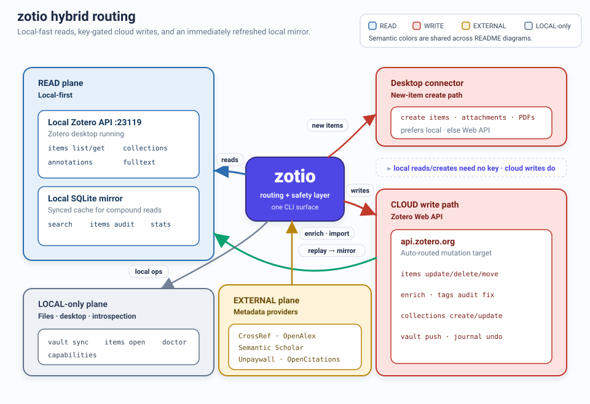
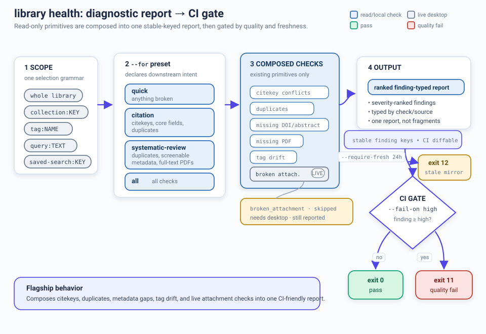
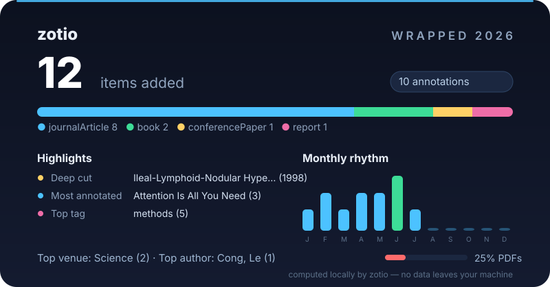

<p align="center">
  <picture>
    <source media="(prefers-color-scheme: dark)" srcset="docs/assets/logo-wordmark-dark.svg">
    <source media="(prefers-color-scheme: light)" srcset="docs/assets/logo-wordmark.svg">
    
  </picture>
</p>

<p align="center">
  <strong>
    The trust-and-automation layer for
    <a href="https://www.zotero.org/">Zotero</a>
  </strong>
</p>

<p align="center">
  <a href="https://github.com/OrgMentem/zotio/actions/workflows/ci.yml"></a>
  <a href="https://github.com/OrgMentem/zotio/actions/workflows/docs.yml"></a>
  <a href="https://go.dev/"></a>
  <a href="LICENSE"></a>
  <a href="https://glama.ai/mcp/servers/OrgMentem/zotio"></a>
</p>

<p align="center">
  <strong>Docs:</strong>
  <a href="https://orgmentem.github.io/zotio/guide/install/"><strong>Get started</strong></a>
  &middot;
  <a href="https://orgmentem.github.io/zotio/reference/commands/"><strong>Commands</strong></a>
  &middot;
  <a href="https://orgmentem.github.io/zotio/guide/mcp-server/"><strong>MCP server</strong></a>
  &middot;
  <a href="https://orgmentem.github.io/zotio/concepts/write-safety/"><strong>Safe writes</strong></a>
  &middot;
  <a href="https://orgmentem.github.io/zotio/guide/workflows/"><strong>Workflows</strong></a>
</p>

<p align="center">
  <code>zotio</code> gives humans, scripts, and MCP agents local-first search
  and auditing, preview-first writes, and bounded, provenance-tagged context
  for Zotero libraries.
</p>

**Fast proof:** check a bundled library before trying zotio on your own data.

```bash
brew install orgmentem/tap/zotio        # or grab a signed binary from Releases
zotio demo                              # bundled library: 34 classic papers, one genuinely retracted
ZOTIO_DEMO=1 zotio --data-source local items retract-check  # check every DOI against Retraction Watch data
```

```console
KEY         STATUS      TYPE        NOTICE DOI                     DATE        SOURCE            TITLE
WAKE2235   correction  correction  10.1016/s0140-6736(04)15715-2  2004-03-06  retraction-watch  Ileal-Lymphoid-Nodular Hyperplasia, Non-Speci...
WAKE2235   retracted   retraction  10.1016/s0140-6736(10)60175-4  2010-02-06  retraction-watch  Ileal-Lymphoid-Nodular Hyperplasia, Non-Speci...
FAIR222U  correction  addendum    10.1038/s41597-019-0009-6      2019-03-19  publisher         The FAIR Guiding Principles for Scientific Da...
Checked 21 DOI-bearing items; 3 update notices flagged; 2 DOI(s) not registered with CrossRef.
```

That is the bundled library catching the retracted Wakefield 1998 MMR paper,
with no Zotero install and no API key (the check queries Crossref live).
`zotio demo --reset` deletes and re-seeds the demo library, restoring it to its original state. To remove it, delete `demo.db` and its `-wal` and `-shm` siblings at the path the demo prints (`db_path` in JSON output).

Zotero itself red-flags a retracted item when you open it, from the same
Retraction Watch data. `zotio` adds what the desktop app does not: corrections
and expressions of concern, a report across a whole library that scripts can
consume, and an exit code CI can fail on.

**Point it at your real library:**

```bash
zotio init                                         # guided setup: detect Zotero, key, first sync, health check
zotio items retract-check                          # the same check, against your real library
zotio library health --for citation --fail-on high # fit to cite? (exit 11 if not)
zotio items bibcheck thesis.tex --fail-on-unknown  # every \cite{} resolves? (exit 11 if not)
```

<p align="center">
  
</p>

---

## Why zotio

Zotero's GUI is great for reading and citing. It is painful the moment you need to *operate* on a library at scale: find every article missing a PDF, catch duplicate `\cite{}` keys before a submission, export a week of highlights, keep an Obsidian vault in sync, or hand an AI agent trustworthy context. Existing CLIs and `pyzotero` give you raw API access — then you write the glue, and you own the risk.

`zotio` provides that glue with these properties:

- **Most reads are local.** Point `zotio` at your running desktop app for keyless reads, or use a synced mirror offline. Web-only reads such as every `items bibliography` format need a Web API key.
- **Writes are preview-first.** Every mutation shows a plan before it touches anything. Gates cap blast radius; irreversible ops require an explicit opt-in; an append-only journal lets you undo the reversible ones.
- **Context is bounded and provenance-tagged.** Every result says where it came from and how fresh it is, so a human or an agent knows whether to trust it. `zotio` **never calls an LLM**; it assembles and budgets the context, then hands it to the model.

It is the tool you reach for when the GUI gets too manual: **find the problems that bite downstream, fix them safely, ingest with review, and give agents a surface they can trust.**

---

## How it works

Most reads stay on your machine; Web-only reads such as `items bibliography` need a Web API key. Writes split by intent: **creating a new item (with its attachments/PDFs) prefers the local desktop connector** (`localhost:23119`, no key — the same channel the browser "Save to Zotero" button uses), while **field edits, deletes, enrichment, tag ops, moves, and `collections` create/update route to the Zotero Web API** and need a configured key. `items new` always needs a key to fetch its Web-only template, even on the connector route. The connector path is a preference: `--via auto` uses it only on a personal library with the desktop running, and falls back to the Web API otherwise (group libraries always go to the cloud). For `attachments add` on an existing item, `--via connector` is an explicit desktop route that still needs a Web API key to move the file to its target. Writes are preview-first; item update reads its version from the Web write target at apply time. Supported applied changes update an existing local mirror so a follow-up read can see them without another sync.



| Plane | Backend | Needs a key? |
|---|---|---|
| **Read** | Local Zotero API (`localhost:23119`) + synced SQLite mirror; Web API for Web-only reads such as `items bibliography` | No, except Web-only reads |
| **Write — new item** | Local desktop connector (`localhost:23119`) when personal + desktop up; else Web API. New items, attachments, PDFs. | No on the connector path, except `items new`, which always needs a Web API key for its template |
| **Write — other items and vault notes** | Zotero Web API (`api.zotero.org`) — edits, deletes, enrich, tags, moves, `collections` create/update, vault write-back | Yes — configured once |
| **External** | CrossRef · OpenAlex · Semantic Scholar · Unpaywall · OpenCitations | No (feeds enrich/import) |
| **Local-only** | Files, desktop launch, vault file sync, introspection | No |

Run `zotio doctor` any time to see connectivity, cache freshness, and a `writes:` line telling you whether write-back is available or read-only.

---

## The flagship: `library health`

One command that answers a real question — *"is this library fit for the next thing I'm going to do with it?"* — in place of six separate audits.



`library health` composes the checks that already exist (citekey conflicts, duplicates, missing metadata, tag drift, broken attachments) into **one ranked, finding-typed report**. You pick what "ready" means with `--for`:

| `--for` | Prepares for | Checks |
|---|---|---|
| `quick` *(default)* | anything obviously broken | citekey conflicts, duplicates, broken attachments |
| `citation` | a manuscript bibliography | missing/duplicate citekeys, citation-core fields, duplicates |
| `systematic-review` | a PRISMA screening corpus | duplicates, missing abstracts, missing full-text PDFs, broken attachment files (with `--verify-files` and a reachable desktop) |
| `vault` | a trustworthy Obsidian/PKM vault sync | missing/duplicate citekeys (note filenames), citation-core fields |
| `all` | a full sweep | every registered check |

```console
$ zotio library health --for quick
Health: needs attention
Scope: library · 846 top-level items (2103 mirrored rows) · source local · synced 1d ago · preset quick

High (13)
  [duplicate_candidates] doi="10.1002/bdm.2118" (2 items)
  [duplicate_candidates] title="Social psychology" (3 items)
  ... 11 more

Skipped (precondition unmet)
  broken_attachment_file — live check (needs Zotero desktop running); off by default.
    Fix: zotio library health --for quick --verify-files

Remediation plan (preview-first)
  duplicate_candidates — zotio items duplicates resolve --doi (preview first; add --yes after review)
```

Three properties make it suitable for gating:

- **It gates CI.** `--fail-on critical|high|info|any|none` exits **`11`** when the bar isn't met — drop it in a pre-submission hook. `--require-fresh 24h` exits **`12`** if your local mirror is stale.
- **It reports what it could not check.** A check that needs the desktop app (broken attachments) becomes a **loud skip with a remedy**. If that skip is gate-relevant, the run exits **`9`** (setup required) instead of passing.
- **It points at the real fixer.** Findings carry a `recommended_action` naming the exact existing command (`items enrich`, `items duplicates resolve`, `tags audit fix`). `library health` reports problems; the named commands fix them.

### CI for your bibliography

`--badge` renders any health run as a [shields.io endpoint](https://shields.io/badges/endpoint-badge) JSON artifact — `healthy` green, findings yellow, gate-failure red, `setup required` orange:

```yaml
# .github/workflows/bibliography.yml (excerpt)
- run: zotio sync
- run: zotio library health --for citation --fail-on high --badge > badge.json
  # exit 11 fails the job when the bar isn't met; badge.json says why
# publish badge.json anywhere shields can reach (gh-pages, gist, artifact host), then:
#   https://img.shields.io/endpoint?url=https://<you>.github.io/<repo>/badge.json
```

Your thesis or review repo gets a live `bibliography | healthy` badge — and a failing build the moment a citekey conflict or duplicate slips in. Add `--check-retractions` to extend the gate to **retracted papers** (Crossref's Retraction Watch data), and gate the manuscript itself with `zotio items bibcheck paper.tex --fail-on-unknown`. The [zotio-action](https://github.com/marketplace/actions/zotio-bibliography-health-for-zotero) packages this — install, sync, gate, and diff against a baseline so it fails only on *new* problems ([guide](https://orgmentem.github.io/zotio/guide/ci/)).

See it running for real: zotio's own docs deploy publishes a [live badge](https://orgmentem.github.io/zotio/bibliography-badge.json) off the maintainer's real Zotero library ([workflow](https://github.com/OrgMentem/zotio/blob/main/.github/workflows/docs.yml), [guide](https://orgmentem.github.io/zotio/guide/ci/)).

---

## Safe by default: the write engine

Mutation-envelope writes — `items enrich`, `tags audit fix`, `items duplicates resolve`, `items preprint-check fix`, `items create/update/move/delete/add-to-collection`, `collections create/update/delete/move`, and `import apply` — share one plan and result format.


- **Preview is the default.** You get a plan/result envelope with zero changes. `--yes` applies; `--dry-run` always wins.
- **A preview predicts the apply.** It runs the same reads and evaluates the same gates (`--max-changes`, `--allow-destructive`, local input checks) as `--yes`. A preview that apply would refuse prints `ok:false` with `error:{code,message}` and exits with the code apply would use. A destructive preview shows `ok:true` only with `--allow-destructive`; a conflict exits `1` in preview and apply alike.
- **`--dry-run` suppresses command writes.** No Zotero write, command output file or its `.lock` sibling, config save, or mirror write-through. Reads still run. Delivery is separate: `--deliver file:<path>` still locks and writes its target, and webhook delivery still sends the output. `sync`, `watch`, and `init` cannot preview and reject `--dry-run` with exit 2.
- **`--agent` does *not* auto-apply.** Agent mode sets JSON + non-interactive defaults, but a write still needs an explicit `--yes`.
- **Gates cap the blast radius.** `--max-changes` defaults to 500 (50 under `--agent`); irreversible ops (merge, permanent delete, collection delete, `creators rename`, `creators audit fix`, `vault resolve --keep-vault|--keep-remote`) refuse to run without `--allow-destructive`.
- **Read-your-writes.** Supported mutation-envelope writes update an existing local mirror when they apply; a follow-up mirror read can see the change without another `sync`.
- **Journaled + reversible.** Each applied mutation-envelope run is recorded append-only (`journal list` / `journal show`). `journal undo <run-id>` reverses the reversible ops (tag renames, collection membership, `items enrich` DOI/abstract/citation-field/tag writes — which also takes the provenance line back out of Extra — and creates, reversed by trashing the created item; `items delete` trashes and `items restore` runs are reversed by the opposite toggle) and **loudly refuses** the rest (merges, permanent deletes, other field overwrites) rather than guessing. Vault writes use the same `--yes` approval gate but have a separate per-note report and no journal entry.
- **Local-state commands.** Commands that destroy local state preview by default and apply with `--yes`: `auth logout` and `profile delete`. Commands that only create local state apply directly: `auth set-token` and `profile save`.

---

## Import without making a mess

Bulk-import references through a review checkpoint. `import apply` writes only after you review and, if needed, edit the manifest.


```bash
zotio import scan ~/Downloads/papers          # read-only: triage new vs duplicate vs attach-candidate
zotio import resolve ~/Downloads/papers > manifest.json   # resolve DOIs → editable manifest
#   ... review and edit manifest.json ...
zotio import apply manifest.json --dry-run     # preview the writes
zotio import apply manifest.json --yes         # schema-valid creation via the Web API
```

- **Scan** classifies a folder of PDFs against your existing library — extracting DOIs from filenames or the PDF bytes — so you never re-import what you already have.
- **Resolve** turns findings into an editable JSON manifest, enriching create-entries from CrossRef. This is the human touchpoint.
- **Apply** creates schema-valid items, preview-first, with an explicit `--attach-mode none|linked-file|stored` contract. `stored` uploads the file bytes: `--via connector` hands the item and its file to Zotero desktop in one session, while the direct Web API route is guarded by the file-storage precondition (`--allow-zotero-cloud` to override).
  After an interrupted stored connector import, reconcile existing items and attachment markers before using `import apply --reimport` to permit another create.
- **`import discover`** follows backward or forward citations from `--scope` into a reviewable manifest at `--output`. Use `--direction backward|forward|both` and `--min-count` to control selection.
- **`import monitor`** queries OpenAlex with `--author` or `--query`, plus `--since`, and writes a manifest at `--output`. It excludes works already in the synced mirror by DOI or normalized title. It keeps no saved state: overlap date windows between runs. Publication-date filters can miss newly indexed or backdated works, and works without DOIs are omitted.

Pass either discovery manifest through `import resolve`, review the result, then use `import apply`.

`resolve` fetches metadata by DOI (CrossRef, with an arXiv-to-DOI lookup for preprint PDFs); it does not resolve PMIDs or ISBNs. The one-shot importers take those identifiers directly: `import doi|pmid|arxiv|isbn|url|file|pdf`. They take the destination collection key with `--to`.

---

## Conflict-safe vault round-trip

Keep an Obsidian or Logseq vault in step with Zotero **in both directions** — without ever clobbering your prose.


```bash
zotio vault sync              # preview: shows the notes it would write
zotio vault sync --yes        # Zotero → one Markdown note per item (idempotent)
zotio vault push --dry-run    # your ## Notes region → a managed Zotero child note
zotio vault pull --dry-run    # remote note edits → your ## Notes region (fast-forward only)
```

Each note has a **managed region** (frontmatter plus fenced title, abstract, and annotations blocks, refreshed on every sync) and **your region** (`## Notes`, prose preserved untouched). Write-back is fast-forward only: if both sides changed, `zotio` never merges blindly — it writes a **reviewable conflict artifact** under `_vault-zotero-conflicts/` and reports it, so divergence becomes something you resolve on purpose (`vault resolve --keep-vault | --keep-remote | --recreate`), never a silent overwrite. Run `vault audit` for a read-only preflight before any push.

Configure the vault once in `~/.config/zotio/config.toml` (the `--vault` flag overrides it):

```toml
[vault]
root = "~/Vaults/dev"    # ~ is expanded; base output dir
notes_dir = "Zotero"     # notes land in <root>/<notes_dir>
format = "obsidian"      # or "logseq"
```

---

## More that the GUI and `pyzotero` don't give you

### Library hygiene, integrity & analytics

- **`items retract-check`** — check every DOI against **Crossref's Retraction Watch data**: retractions, expressions of concern, and corrections, with notice DOIs and dates. Opt into the `library health` gate with `--check-retractions`. *(This one reads the network.)*
- **`collections gaps`** — citation-graph gap analysis: rank the papers your collection cites most that are **missing from your library** (OpenCitations + Semantic Scholar), then `import doi` them. *(Network too.)*
- **`items bibcheck <manuscript>`** — parse `\cite{}`/`@citekey` from `.tex` or pandoc Markdown, or read the Zotero citation fields in `.docx` and `.odt` files, and resolve every key against your library — unknown and ambiguous keys flagged, and an unknown key carries the closest keys in your library as an advisory suggestion when one is close enough to name, so a one-character typo is a named fix rather than a hand-grep of the `.bib`. `--fail-on-unknown` exits 11 for CI. `--check-retractions` also looks up the DOI of each cited item at CrossRef (network) and reports retractions (critical) and expressions of concern (high) at the citing line; a lookup that fails is reported as skipped and exits 9 under `--fail-on`.
- **`tags audit`** — group tags that differ only by case or variant, with item counts and **ready-to-run merge commands**. On a real 840-tag library it surfaced 53 duplicate groups in one pass.
- **`library stats`** — a one-command dashboard: items by type and year, top venues, PDF coverage, and optional intake buckets with `--added-by month|year`.
- **`items audit`** — count and list items missing PDFs, abstracts, DOIs, tags, or citation-core fields; `--verify-files` checks PDFs actually exist on disk.
- **`items duplicates`** — detect likely duplicates by DOI or title (attachments/notes excluded), then `duplicates resolve` to merge safely.
- **`items citekey-conflicts`** — find missing or duplicate Better BibTeX keys before they break a LaTeX build.
- **`items find`** — resolve a DOI, ISBN, PMID, arXiv ID, citation key, URL, OpenAlex work ID, or exact title against the local mirror before importing a duplicate. A title matches whatever its case, whitespace, quote and dash styling, or trailing full stop, so a title pasted from a reference list resolves. When the lookup as a whole matches nothing, the closest titles or keys in the library are listed separately with a score, so a typo is distinguishable from an absent paper; they are suggestions to confirm, never matches. The selectors are OR-ed, so a run that matched on another selector reports no near rows for the one that missed.

### Reading & synthesis

- **`items summarize`** — assemble a bounded, synthesis-ready bundle for an item or collection (citation + abstract + your annotations + a capped fulltext excerpt + known metadata gaps + a synthesis prompt) and hand it to any LLM. `zotio` does the budgeting; it never calls the model. Ask a question with `--focus "TERMS"` and each item instead carries the ranked PDF-text passages and annotations that match, with item and attachment keys — `--max-chars` caps the passages and `--max-annotations` the annotations — so a finding on page 30 beats the introduction. An item with no synced PDF text says so rather than reporting "no match".
- **`annotations export` · `annotations timeline` · `annotations search`** — pull highlights and notes as Markdown or JSON (`annotations export --output|-o` writes a file), ordered by date or searched by text.
- **`reading-list`** — a `to-read` tag queue with an `add` → `start` → `done` lifecycle for triaging what to read next.
- **`items note-template`** — generate a pre-filled Obsidian/Logseq reading note for an item.
- **`items open`** — print or launch a `zotero://` deep link to an item, collection, or PDF (cross-platform).
- **`library wrapped`** — your Zotero year in review: hero counts, monthly rhythm with peak highlight, a type-mix ratio bar, highlights (busiest day, longest streak, deep cut, most-annotated paper, top tag), top venues and full author names, PDF coverage — plus a shareable SVG card in four layouts via `--card-style overview|rhythm|picks|cycle` (the card below is `cycle`, crossfading through all three):

<p align="center">
  
</p>

### Enrichment (reads external APIs, writes Zotero)

- **`items enrich`** — fill missing DOIs and abstracts from **CrossRef → OpenAlex → Semantic Scholar**; fill missing citation fields from **CrossRef**; attach open-access PDFs from **Unpaywall**; and record provenance in each item's Extra field. `--missing-citation` fills only blank fields supported by the item type, including provider-backed volume, issue, and pages. `--missing-mesh` proposes PubMed MeSH descriptors as automatic `mesh/<descriptor>` tags for items with a PMID or a DOI that PubMed knows, previews by default, and reports a PubMed outage as an error. `--validate` reports title, year, and render-field discrepancies against CrossRef, plus DOI registration failures from OpenCitations, without writing.
- **`items preprint-check`** — find arXiv preprints that now have a published CrossRef record; `preprint-check fix` upgrades them with the journal DOI — preview-first, journaled, and it never overwrites a conflicting DOI.

### Export & reproducibility

- **`items bibliography`** — render a shared scope with a CSL style, or export it as CSL-JSON, BibTeX, BibLaTeX, or RIS. Every format needs a Web API key for server-side rendering at `api.zotero.org`. CSL-JSON uses unique Better BibTeX citation keys for Pandoc and Quarto. `--manuscript paper.tex` (or a `.docx`/`.odt` written with the Zotero plugin) exports only the items a manuscript cites — in first-citation order for the export formats, while a CSL-rendered `bib` keeps its style's sort — and refuses (exit 11) on unknown or ambiguous citekeys. `--scope` accepts AND-joined cohorts such as `collection:KEY AND tag:NAME`.
- **`collections export`** — a whole collection and all its subcollections as one BibTeX, RIS, or CSL-JSON file. Items from the subtree are included recursively; the file does not encode collection hierarchy.
- **`export snapshot`** — a reproducible, resumable, fully paginated export (JSONL by default; `--format bibtex|ris|csljson`) with a `<output>.manifest.json` content manifest (sorted key+version + sha256) for drift detection and clean review handoffs.

### Freshness & schema

- **`sync` · `watch` · `tail`** — populate the mirror, keep it fresh with periodic incremental syncs, or stream live changes. `watch --health` diffs `library health` between cycles and reports **new findings** to stdout or a webhook — hear about drift the cycle it appears. Add `--health-check-preprints` to also watch the library's arXiv preprints: a preprint that gains a published record is reported once as a `preprint_published` finding. Answers are cached for `--health-preprint-recheck` (default `7d`, at least `1h`), and a provider failure is logged as a skip, never an all-clear.
- **`schema drift`** — after a Zotero upgrade, detect item-type / field / creator-field changes against a saved baseline.

---

## Built for agents

`zotio` publishes a machine-readable trust model so an MCP host, CI job, or shell script can discover what's safe, fresh, and writable *before* it acts.

- **`--agent`** on any command: JSON + compact + non-interactive + no color, in one flag. (It never auto-applies writes.) Under `--json`/`--agent` a typed error prints one flat JSON object `{kind, code, message, hint?}` on stdout; a failed mutation keeps its `ok:false` envelope, and a `which` miss prints `{"matches":[]}` and exits 2.
- **`capabilities`** — the full command registry, each tagged with `operation`, `data_sources`, `write_target`, `destructive`, and `requires` preconditions. Commands with several write routes also list each route's target and preconditions.
- **`agent-context`** — a structured description of the whole CLI, embedding the registry and discovery hints, the `exit_codes` table, the `global_flags` (listed once, not per command), and `annotation_semantics`, which explains the three-state `mcp:read-only` annotation.
- **`which "<capability in your words>"`** — resolve a natural-language query to the command that does it.
- **Stable envelopes** — one mutation plan/result shape, one finding shape, and one exit-code contract across commands.

**Scope grammar** — one selection vocabulary across reads, audits, exports, enrich, and full-text search (`search QUERY --fulltext --scope collection:KEY` ranks and limits inside the cohort):

```
collection:KEY   tag:NAME   query:TEXT   item:KEY   saved-search:KEY
<arm> AND <arm>   # intersection, e.g. collection:KEY AND tag:NAME
```

Join arms with ` AND ` (capital letters, a space on each side) to select only the items that match every arm, for example `zotio items enrich --missing-doi --scope 'collection:ABCD1234 AND tag:include'`. The text splits only where ` AND ` is followed by another arm, so `query:trust AND safety` stays one query. `library` cannot be an arm of an intersection (exit 2). A saved-search arm that cannot be evaluated refuses with exit 9 instead of counting as empty.

`saved-search:KEY` is evaluated by Zotero desktop when it answers. When the desktop is not reachable or refuses local API access, zotio evaluates the synced search definition against the local mirror and prints a `notice:` line; `--data-source live` turns the fallback off. The local evaluator supports text fields, creator, tag, collection, item type, and date conditions with any/all join and the child-item flags. A search that uses any other condition (full text, notes, nested searches) exits 9 naming the condition.

**Exit codes** (the same table is in `SKILL.md` and under `exit_codes` in `agent-context --json`):

| Code | Meaning |
|------|---------|
| 0 | Success |
| 1 | General error (anything without a typed code, or a write where nothing applied) |
| 2 | Usage error: bad flag value, wrong argument count, invalid key, invalid enum or limit, mutually exclusive flags; also a `which` miss and `--dry-run` on `sync`/`watch`/`init` |
| 3 | Resource not found: the key or name does not exist |
| 4 | Authentication required |
| 5 | API error (upstream issue) |
| 7 | Rate limited (wait and retry) |
| 9 | Precondition unmet: unsynced store, Zotero or the Web API unreachable when required, or a writer lock is held |
| 10 | Config error |
| 11 | Quality gate failed (`--fail-on` on `library health`, `items bibcheck`, `doctor`; `items bibcheck --fail-on-unknown`) |
| 12 | Stale data (`--require-fresh`) |
| 13 | Incomplete — part of a write applied and part failed for a non-conflict reason, or part of a read was unreadable; reconcile before retrying |
| 14 | Timed out — `desktop wait --timeout` ended before Zotero's connector answered; wait again |
| 15 | Zotero is open but its connector is hung or off (`desktop wait`); tell the user rather than wait |

An explicit `--help` exits 0.

---

## Install

`zotio` comes in three pieces you can install independently: the **CLI** (the engine — everything runs through it), the **agent skill** (drives the CLI inside coding agents), and the **MCP server** (exposes the CLI to MCP hosts like Claude Desktop). Most people want the CLI; add the skill or MCP server for your agent of choice.

### 1. The CLI — `zotio`

**Homebrew (macOS):**

```bash
brew install orgmentem/tap/zotio
```

This installs both `zotio` and the `zotio-mcp` MCP server; `brew upgrade` tracks new releases.

**Linux (deb / rpm / apk):** there is no apt/dnf/pacman repository — the packages
are [GitHub release](https://github.com/OrgMentem/zotio/releases) assets. Install
with `dpkg -i`, `rpm -i`, or `apk add --allow-untrusted`; the
[install guide](https://orgmentem.github.io/zotio/guide/install/) has a snippet
that resolves the latest version and your architecture.

**Windows (WinGet / Scoop):** `winget install OrgMentem.zotio`, or
`scoop bucket add orgmentem https://github.com/OrgMentem/scoop-bucket && scoop install zotio`.
Both install `zotio` and `zotio-mcp`. WinGet can serve the previous version for
a short window after a release while Microsoft merges the version bump; Scoop
updates immediately.

**Prebuilt binaries:** every [GitHub release](https://github.com/OrgMentem/zotio/releases) ships archives for macOS, Linux, and Windows (amd64/arm64) with cosign-signed checksums and SBOMs. Unpack and put `zotio` on your `PATH`; on macOS clear the Gatekeeper quarantine (`xattr -d com.apple.quarantine zotio`), on Unix `chmod +x zotio`.

**From source:**

```bash
git clone https://github.com/OrgMentem/zotio && cd zotio && go build -o zotio ./cmd/zotio
```

Then let the CLI walk you through setup — Zotero detection, the local-API toggle, an optional Web API key, first sync, and a health check:

```bash
zotio init
```

### 2. The agent skill

A focused skill — bundled in this repo as [`SKILL.md`](SKILL.md) — that teaches a coding agent to drive the CLI directly (the most efficient path; no MCP server in the middle).

**Recommended — the [`skills` CLI](https://skills.sh)** (works across Claude Code, Cursor, Codex, Cline, opencode, and 40+ agents):

```bash
npx skills add OrgMentem/zotio          # detect your agents and install
npx skills add OrgMentem/zotio --list   # preview without installing
npx skills add OrgMentem/zotio -g       # install globally (all projects)
```

**Manual:**

- **Claude Code:** copy `SKILL.md` into `~/.claude/skills/zotio/SKILL.md` (or your project's `.claude/skills/zotio/`).
- **Any other agent:** point it at the raw file — `https://raw.githubusercontent.com/OrgMentem/zotio/main/SKILL.md` — or paste it into your agent's skill store.

### 3. The MCP server — `zotio-mcp`

`zotio-mcp` ships alongside the CLI — the macOS Homebrew cask and every release archive include both binaries. Register it:

```bash
# Claude Code
claude mcp add zotero zotio-mcp -e ZOTERO_API_KEY=<your-key>
```

For Claude Desktop, every [release](https://github.com/OrgMentem/zotio/releases) ships per-platform [MCPB](https://github.com/modelcontextprotocol/mcpb) bundles — download the `.mcpb` for your platform, double-click it, and Claude Desktop walks you through the install.

<details>
<summary>Claude Desktop manual JSON config (advanced)</summary>

Install the `zotio-mcp` binary and add to `~/Library/Application Support/Claude/claude_desktop_config.json`:

```json
{
  "mcpServers": {
    "zotero": {
      "command": "zotio-mcp",
      "env": { "ZOTERO_API_KEY": "<your-key>" }
    }
  }
}
```

</details>

The `ZOTERO_API_KEY` is optional for read-only local-desktop use (the local API needs no key); set it to enable writes and reach group libraries.

---

## Authentication

**Reads** go to your Zotero desktop app at `localhost:23119` — no API key required while Zotero is running. First enable the local API in Zotero: **Settings → Advanced → "Allow other applications to communicate with Zotero."**

**Creating** a new personal-library item and saving its attachments together can work keyless through the local desktop connector. `attachments add` on an existing item needs a Web API key, even with `--via connector`: that route moves the new attachment to its target through the Web API.

**Editing writes** (`items update`/`delete`/`move`, `items enrich`, `tags` mutations, `vault push`/`pull`/`resolve`, most of `import apply`) route to the Zotero Web API and need a key. Configure it once:

```bash
printf %s "$ZOTERO_API_KEY" | zotio auth set-token --stdin     # or export ZOTERO_API_KEY=<key>
```

Generate a key at <https://www.zotero.org/settings/keys>. The first Web API write prints a one-time stderr notice naming the target. A key is also needed for remote Web API reads, including group libraries. Supported `--data-source local` reads use a synced mirror without the desktop app or a key. Run `zotio doctor` to see a `writes:` line reporting whether write-back is available.

---

## Use

### Use the CLI directly

```bash
# 1. Verify Zotero is running and reachable
zotio doctor

# 2. Sync your library to local SQLite for offline search + analytics
zotio sync

# 3. See the shape of your library
zotio library stats

# 4. Certify it for a citation handoff (exit 11 if it fails the bar)
zotio library health --for citation --fail-on high

# 5. Search offline
zotio search 'automation trust' --fulltext --data-source local --json

# 6. Export annotations since a date as JSON for synthesis
zotio annotations timeline --since 2026-05-01 --json > since-may.json
```

### Use the skill in a coding agent

Once installed (above), invoke `/zotio <query>` in Claude Code. The skill drives the CLI directly — the most efficient path, no MCP server in the middle.

### Use the MCP server in an agent host

Once registered (above), the MCP server exposes a **command-orchestration facade** (`command_search` / `command_run`) rather than one tool per endpoint — agents discover and drive the CLI the same way a human would (see [`dev/adr/0001-mcp-command-surface.md`](dev/adr/0001-mcp-command-surface.md); switch surfaces via `ZOTIO_MCP_SURFACE`). Commands that write local files expose `--dry-run`, and `annotations search` is available. Tool hints come from the capability registry: `destructiveHint` is true only for destructive commands and local file writers, and commands that read only the local mirror report `openWorldHint: false`. It also serves Zotero context as **resources** — `zotero://context`, `zotero://agent-context`, `zotero://status`, `zotero://schema`, `zotero://freshness`, `zotero://health/{scope}`, `zotero://capabilities`, and bounded graph resources (`collections/{key}/tree`, `items/{key}/children|attachments|context`) — plus guided **prompts** (prepare-library-health, prepare-import, sync-vault-safely, inspect-library, export-reading-notes, prepare-citation-export, synthesize).

---

## Output formats

```bash
zotio collections list                       # human table (JSON when piped)
zotio collections list --json                # JSON for scripting and agents
zotio collections list --json --select key,data.name   # only the fields you need
zotio collections list --dry-run             # no write of any kind; reads like this one still run
zotio collections list --agent               # JSON + compact + non-interactive + no color
```

Also available: `--csv`, `--plain` (commands with no tabular form reject both with exit 2), `--quiet` (print nothing; the exit code is the answer), `--compact`, and `--deliver stdout|file:<path>|webhook:<url>`. `--deliver` routes the command's output, also under `--dry-run`. `--select` naming a field the output lacks exits 2.

---

## Health check & troubleshooting

```bash
zotio doctor            # config, credentials, connectivity, cache freshness, writability
zotio desktop status    # is Zotero desktop running, and does its connector accept imports?
```

- **`doctor: connection refused`** — open Zotero desktop and enable **Settings → Advanced → "Allow other applications to communicate with Zotero."**
- **`items missing-pdf` / analytics / any mirror reader fail with exit 9** — the local mirror is not synced. Run `zotio sync` first; the `synced_store` precondition envelope says so.
- **`annotations export` outputs empty sections** — PDF annotations must be made in Zotero's built-in PDF reader, not an external app.
- **`citekey-conflicts` finds no keys** — install the Better BibTeX extension. zotio reads its `citationKey` field through the local API, then falls back to pinned keys in `Citation Key:` lines in Extra.
- **Authentication errors (exit 4)** — `zotio doctor` to check credentials; verify `echo $ZOTERO_API_KEY`.

---

## Configuration

Config file: `~/.config/zotio/config.toml`. Static request headers can be set under `[headers]`; per-command overrides take precedence.

An explicit `--config` path must exist, or the command exits 10. Exceptions are `init`, `auth set-token`, `auth logout`, help, version, and completion.

| Variable | Default | Description |
|---|---|---|
| `ZOTERO_API_KEY` | unset | Required for writes (routed to the Zotero Web API), group libraries, and access while the desktop app is closed. Local desktop reads need no key. Configure once by piping the token into `zotio auth set-token --stdin`. |
| `ZOTERO_USER_ID` | from config | Overrides the Web API user ID, so writes route without a `keys/current` lookup. |
| `ZOTERO_BASE_URL` | config value | Overrides the API base URL (used for tests and mock servers). |
| `ZOTERO_CONFIG` | `config.toml` in the config directory | Path of the config file to load. |
| `ZOTERO_PROFILE` | unset | Profile name; the `--profile` flag takes precedence. `zotio-mcp` also reports it at startup. |
| `ZOTERO_PROFILE_DIR` | auto-discovered | Pins the Zotero desktop profile directory instead of discovering it. |
| `ZOTERO_GROUP` | unset | Group library ID; the `--group` flag takes precedence. `zotio-mcp` requires a numeric ID. |
| `ZOTERO_QUEUE_TAG` | `to-read` | Tag that `reading-list` uses as its queue. |
| `ZOTERO_CONFIG_DIR`, `ZOTERO_DATA_DIR`, `ZOTERO_STATE_DIR`, `ZOTERO_CACHE_DIR` | platform default | Absolute directory for that kind of file. Each takes precedence over `ZOTERO_HOME` and the XDG variables. |
| `ZOTERO_HOME` | unset | Absolute base directory; `config`, `data`, `state`, and `cache` subdirectories live under it. |
| `ZOTIO_DEMO` | unset | Any value other than empty or `0` runs commands against the bundled demo library. |
| `UNPAYWALL_EMAIL` | unset | Contact email that `items enrich` uses for Unpaywall lookups. |
| `ZOTIO_MCP_SURFACE` | `facade` | `mirror` registers one MCP tool per command; any other value keeps the `command_search` and `command_run` pair. |
| `ZOTIO_MCP_TRANSPORT` | `stdio` | Transport for `zotio-mcp` (`stdio` or `http`). |
| `ZOTIO_MCP_TOKEN` | generated per run | Bearer token that the `zotio-mcp` HTTP transport requires. `--mcp-auth-token-file` takes precedence. When neither is set, the server generates a token for each start and writes it to a private file in the state directory. |
| `ZOTERO_FEEDBACK_ENDPOINT` | unset | Public `https://` URL that receives `zotio feedback` entries as JSON. Entries always go to `~/.zotio/feedback.jsonl` first; they are posted only with `--send` or `ZOTERO_FEEDBACK_AUTO_SEND`. |
| `ZOTERO_FEEDBACK_AUTO_SEND` | off | `1`, `true`, or `yes` posts each feedback entry to the endpoint without `--send`. A failed automatic send prints a warning and the command still exits 0. |

---

## Command reference

Run `zotio --help` for the full command list, or `zotio <command> --help` for any subcommand. Ask the CLI directly when you know the goal but not the command:

```bash
zotio which "export bibtex for a collection"
```

<details>
<summary>Top-level commands</summary>

`agent-context` · `analytics` · `annotations` · `attachments` · `auth` · `capabilities` · `collections` · `completion` · `creators` · `demo` · `desktop` · `doctor` · `export` · `feedback` · `groups` · `import` · `init` · `items` · `journal` · `library` · `profile` · `reading-list` · `schema` · `search` · `searches` · `sync` · `tags` · `tail` · `vault` · `version` · `watch` · `which` · `workflow`

</details>

## Sister project: *papio*

zotio manages and safeguards your Zotero library. [*papio*](https://github.com/orgmentem/papio) is the acquisition side: it finds and downloads validated, provenance-tracked PDFs from open access and your own institutional subscriptions through your normal browser, then hands them to zotio for preview-first import. If your library has items without PDFs, *papio* fills them.

---

## Sources & inspiration

Built by studying these projects and resources:

- [**cli-anything-zotero**](https://github.com/PiaoyangGuohai1/cli-anything-zotero) — TypeScript
- [**54yyyu/zotero-mcp**](https://github.com/54yyyu/zotero-mcp) — Python
- [**pyzotero**](https://github.com/urschrei/pyzotero) — Python
- [**kujenba/zotero-mcp**](https://github.com/kujenba/zotero-mcp) — Python
- [**jbaiter/zotero-cli**](https://github.com/jbaiter/zotero-cli) — Python
- [**dhondta/zotero-cli**](https://github.com/dhondta/zotero-cli) — Python
- [**Combjellyshen/ZoteroBridge**](https://github.com/Combjellyshen/ZoteroBridge) — TypeScript
- [**RaulSimpetru/zotero-library-mcp**](https://github.com/RaulSimpetru/zotero-library-mcp) — Python
- [**introfini/mcp-server-zotero-dev**](https://github.com/introfini/mcp-server-zotero-dev) — TypeScript
- [**piiinpiiins/zotero-mcp-local**](https://github.com/piiinpiiins/Zotero-MCP-lite) — Python
- [**mcp-for-zotero**](https://mcpforzotero.alejandroarnaud.dev) — hosted service

---

Licensed under MIT.

Zotero is a registered trademark of the [Corporation for Digital Scholarship](https://digitalscholar.org/). zotio is an independent project and is not affiliated with or endorsed by Zotero or the Corporation for Digital Scholarship.
